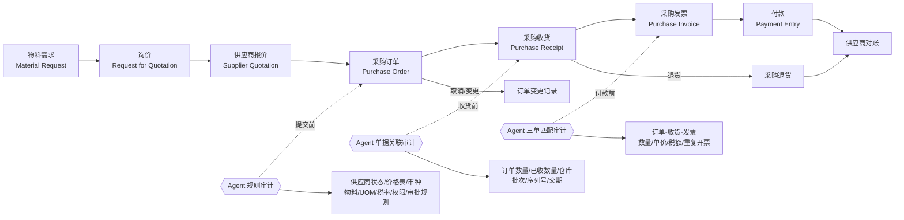

# ERPNext 采购流程与 Agent 审计点

> Historical reference only. ADR 0005 replaced ERPNext as the planned production
> core with an independently implemented lean ERP. This document remains useful for
> studying business flow; it is not the new system specification.

本流程用于个人快消经销演示。ERPNext 提供业务单据与状态流转；ERPRAG Agent
负责只读检索、关联规则、检查冲突和输出证据，不替代 ERPNext 的提交与审批控制。

## 审计触发点

1. **采购订单提交前**：校验供应商、采购价格、计量单位、税率、收料仓、审批门槛和规则引用。
2. **采购收货提交前**：校验订单剩余数量、允许超收比例、仓库、批次/序列号和交期。
3. **采购发票提交前**：执行采购订单、收货单、发票三单匹配，检查数量、价格、税额和重复开票。
4. **付款审批前**：检查发票状态、未付金额、付款条件、供应商账户和审批路径。
5. **规则或主数据变更后**：价格表、供应商组、物料、权限、工作流或采购设置变更时，重新扫描受影响单据。

审计结果只使用三种结论：`confirmed_violation`、`compliant`、`inconclusive`。
缺少来源、规则范围不明或多个规则冲突时必须返回 `inconclusive`，不能推断为合规。

## 当前实例证据

- 采购入门指南显示 6/6 步骤完成。
- 采购设置已指定 `Standard Buying`，并启用采购周期保持相同价格。
- 实例存在已提交采购订单 `PUR-ORD-2026-00011`：供应商“宏程商贸”，
  公司“仁和商贸 (Demo)”，物料“牛奶”，数量 2，单价 CNY 12.00，
  状态为“待入库与开票”。

以上仅描述本地演示实例，不代表原始小天元 ERP 的实际规则。
